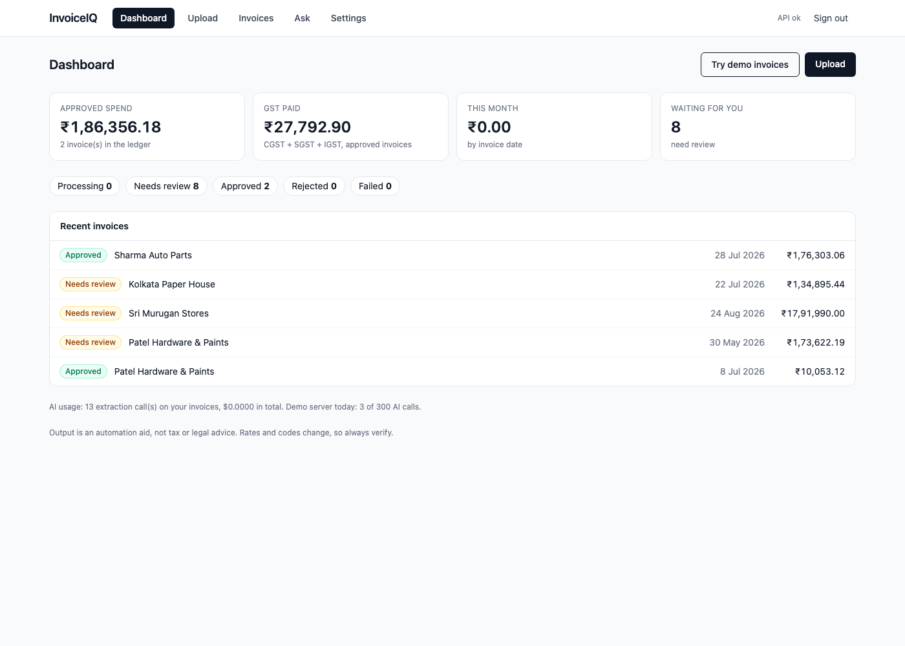
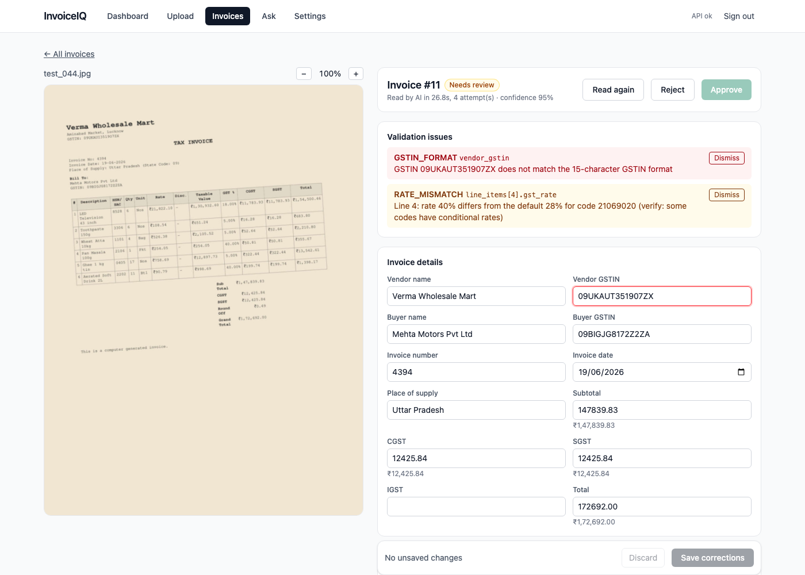
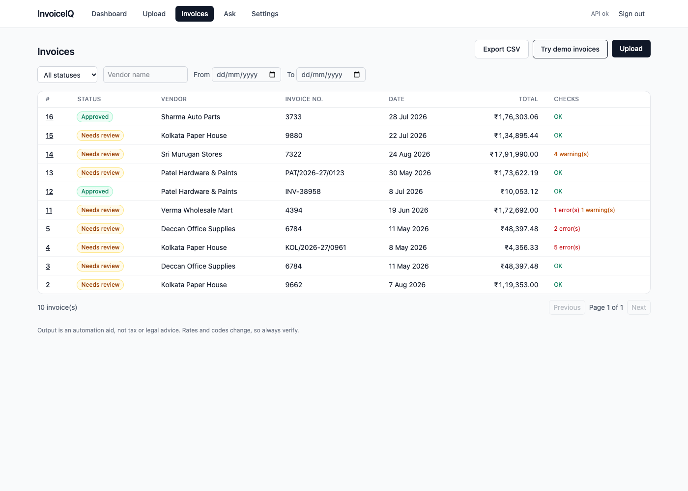
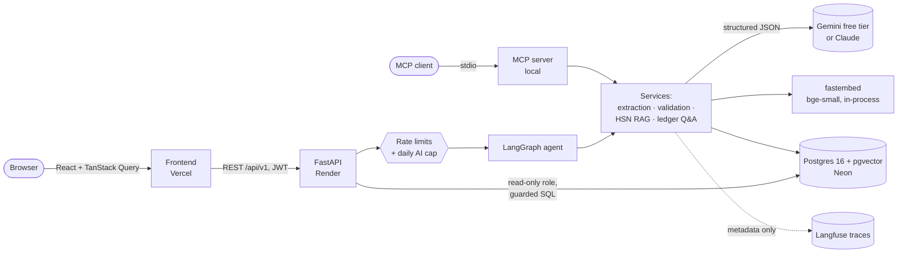
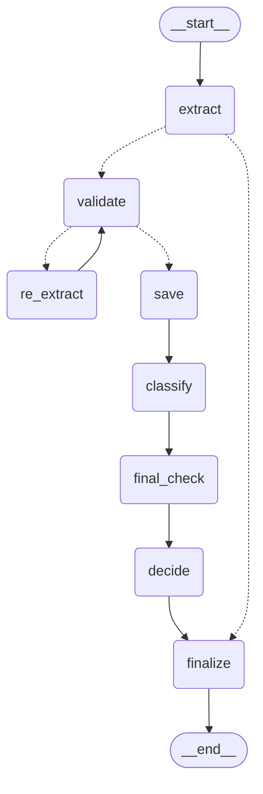

# InvoiceIQ

An AI agent that reads Indian GST invoices (photos, scans or PDFs), extracts and validates every field, suggests the HSN/SAC code and GST rate for each line, lets a person review and approve the result, and answers questions about the ledger in plain English.

[](https://github.com/arpittts/invoiceiq/actions/workflows/ci.yml)

**Live demo:** https://invoiceiq-teal.vercel.app (sign up, then click **Try demo invoices**; the free backend sleeps when idle, so the first request can take about a minute)  
**Demo video (60 s):** attached to the [v1.0.0 release](https://github.com/arpittts/invoiceiq/releases/tag/v1.0.0)  
**Release:** v1.0.0. The full build plan is in [docs/BLUEPRINT.md](docs/BLUEPRINT.md).

> Disclaimer: output is an automation aid, not tax or legal advice. Rates and codes change, so always verify.

## Problem and solution

Small Indian businesses receive GST invoices as PDFs, scans and phone photos. Typing them into the books is slow, and the mistakes that matter (a misread GSTIN, a wrong tax split, a total that doesn't add up, the wrong HSN code) are easy to miss and expensive at filing time.

InvoiceIQ reads each invoice with a vision LLM, but never trusts it blindly:

- the model copies values **exactly as printed**; our code parses them and runs **deterministic GST checks** (GSTIN checksum, state codes, CGST/SGST vs IGST, line, tax and total arithmetic, dates, duplicates);
- when a check fails, a **LangGraph agent** re-reads only the failing fields, at most twice, within a token and cost budget;
- every line gets an **HSN/SAC suggestion** from the official code list (hybrid vector + keyword search, then an LLM that must cite a candidate);
- a **person reviews** anything with issues; auto-approve is opt-in and strict;
- approved invoices form a **ledger** you can query in English, through a guarded, read-only text-to-SQL path.

Every number below comes from a frozen, held-out test set; see [Evaluation](#evaluation).

## Screenshots

| Dashboard | Review: a misread GSTIN on a blurred photo, caught by the checksum rule | Invoice list after loading the demo |
| --- | --- | --- |
|  |  |  |

## Architecture



- **Frontend** (React 19, Vite, TypeScript, Tailwind): dashboard, upload, invoice list, review, Ask and Settings pages.
- **API** (FastAPI): auth, uploads (type sniffing, size and page limits), review actions, CSV export, dashboard, settings; processing runs as a background task.
- **Agent** (LangGraph): extract → validate ⇄ targeted re-read → save → classify → final check → decide (see [the agent](#the-agent-langgraph)).
- **Database** (Postgres + pgvector): invoices, line items, every LLM attempt, validation issues, an audit trail of human edits, 22,609 official HSN/SAC codes with embeddings, and read-only ledger views. Files are stored as database blobs in production, because the free host's disk is wiped on restart.

## Features

- **Upload** PDFs, PNGs and JPEGs (drag and drop, progress); type checked by magic bytes, not file names.
- **Extraction** with per-field confidence and schema retries; every attempt stored with tokens, cost and latency.
- **Validation**: 10 deterministic GST rules, issues pinned to fields.
- **HSN/SAC suggestions** with the official source row and indicative rate.
- **Review**: page image beside an editable form, issues highlighted, low-confidence fields marked, approve/reject/read again, full audit trail.
- **Ledger Q&A**: an answer, the SQL that produced it and the rows.
- **Dashboard** (spend, GST, counts, recent invoices, AI usage), **Settings** (auto-approve and its thresholds per user), **CSV export** of approved invoices (formula-injection safe).
- **Try demo invoices**: six bundled synthetic invoices, read instantly by replaying recorded model replies, so the demo works even when the daily AI cap is reached.
- **Demo safety**: per-user and per-IP rate limits, a daily cap on model calls and spend, and a clear message when the cap is hit.
- **MCP server**: the same services as tools for MCP clients such as Claude.

## Tech stack

| Layer | Choice |
| --- | --- |
| Backend | Python 3.12, FastAPI, Pydantic v2, SQLAlchemy 2, Alembic |
| Agent | LangGraph |
| LLM | Google Gemini (`gemini-3.5-flash-lite`, free tier) by default; Anthropic Claude supported (`LLM_PROVIDER=anthropic`) |
| Retrieval | pgvector (HNSW, cosine) + Postgres full-text, reciprocal rank fusion; fastembed `BAAI/bge-small-en-v1.5` |
| SQL safety | sqlglot allow-list + a no-login read-only Postgres role |
| PDF rendering | PyMuPDF |
| Tracing | Langfuse (metadata only) |
| Frontend | React 19, Vite, TypeScript, Tailwind CSS v4, TanStack Query, React Router |
| Tests and CI | pytest, vitest, ruff, oxlint, GitHub Actions with a replayed evaluation gate |
| Hosting (free tiers) | Vercel (frontend), Render (API, Docker), Neon (Postgres) |
| Integrations | MCP server (official `mcp` Python SDK) |

## How it works

### Extraction

After upload, a background task renders each page to an image and sends it to a vision LLM with a strict JSON schema (structured outputs). The provider is a setting: **Google Gemini's free tier** by default (`LLM_PROVIDER=gemini`, model `gemini-3.5-flash-lite`), or Anthropic Claude (`LLM_PROVIDER=anthropic`, paid). Gemini's free tier may use inputs to improve Google's products, so only synthetic or demo invoices are sent to it. The model copies every value exactly as printed, with a confidence from 0 to 1; our own code then parses amounts into `Decimal`, dates (day-first, as on Indian invoices) and rates. If that validation fails, the model is asked again with the error (up to 2 retries). Every attempt is stored in `extraction_runs` with tokens, cost and latency, and traced in Langfuse without any invoice contents.

Safety: the extraction call has no tools, our instructions live in the system prompt, and invoice text is treated as untrusted data.

Test data: `make invoices` regenerates 20 synthetic invoices (4 layouts, PDF/scan/photo, CGST+SGST and IGST) with exact ground truth in `evals/datasets/starter/`. `make check-extraction` runs real extraction on them and reports the valid-schema rate, cost and latency (it asks before calling the API).

### The agent (LangGraph)

Processing an invoice is a LangGraph state graph (`backend/app/agent/`). This diagram is generated from the code:



- **validate → re_extract:** if the deterministic rules find errors, the model re-reads the page with the failing fields and rule messages named, and only those fields (and their line items) are merged into the first read, so correct fields can't get worse. At most 2 re-reads (`MAX_REEXTRACTIONS`), and only within the per-invoice token and cost budget.
- **classify** runs once, after the numbers are settled, so re-reads don't repeat the HSN lookup.
- **decide:** auto-approve is off by default; each user can switch it on and set its thresholds on the Settings page (the server default is `AUTO_APPROVE_ENABLED`). When on, it needs no errors or warnings, overall confidence of at least 0.9 and a confident HSN/SAC code on every line. Everything else goes to human review.
- **No infinite loops:** the re-read cap, the budget and LangGraph's recursion limit (25 steps; the longest legal path is 11). A test raises the cap to 1,000 and checks the recursion limit still stops the run.
- Each run is one Langfuse trace whose output is the path taken, the decision and the reason.

### Review

The frontend (React + Vite + TypeScript + Tailwind + TanStack Query) has sign-in, an upload page (drag and drop, progress), an invoice list (filters, auto-refresh while extracting) and a review screen: the page image next to editable fields, validation issues highlighted on their fields, low-confidence fields marked "check", and Approve / Reject. Approve stays disabled until every error is fixed (validation re-runs on save) or dismissed. Every human change is stored in `review_events` as an audit trail. Run `npm test` in `frontend/` for the unit tests.

## Evaluation

One command runs the whole pipeline (the LangGraph agent, validation, HSN suggestions, auto-approve decision) on a frozen test set and the ledger questions, and writes a JSON and Markdown report to `evals/reports/`:

```bash
make eval          # replays recorded model replies: free, no API key, ~10 s (what CI runs)
make eval-record   # calls the real model and refreshes the recordings (free on Gemini, ~40 min)
```

**Test set:** 60 synthetic invoices, generated once (`make invoices-test`, seed 2026) and never used while building. They are harder than the 20 dev invoices: low-resolution scans (80-100 dpi), blurred phone photos rotated 2.5-4.5°, faint low-contrast photocopies, 30-40 line bills that run onto a second page, more fonts and sizes, 2-digit years and "Rs." amounts.

**Results** (test split, `gemini-3.5-flash-lite` free tier, recorded 2026-10-19; full report: [evals/reports/eval-test-20261019-094649.md](evals/reports/eval-test-20261019-094649.md)):

| Metric | Result |
| --- | --- |
| Field accuracy (exact match, every header and line field) | **99.8%** |
| Invoices read fully correctly | **88.3%** (53/60) |
| By file type, fully correct | PDF 94.7%, 2-page PDF 100%, photocopy 91.7%, scan 83.3%, photo 75.0% |
| False alarms on correctly read invoices | **0%** |
| Real misreads flagged by validation | 3/7 (every misread that changed an amount or GSTIN was flagged; the 4 unflagged were a stray "." in a description and blank or unprinted line totals) |
| Injected misreads caught by validation | **98.1%** of 1,944 |
| Auto-approve precision | **100%** (9 approved, 0 wrong) |
| Ledger Q&A execution accuracy | 86.7% strict, 93.3% lenient (30 questions) |
| Adversarial ledger prompts | 8/8 safe, database unchanged |
| Cost per invoice | $0 (free tier) |
| Latency per invoice, p50 / p95 | 8.6 s / 35.6 s |

How to read these: the invoices are synthetic, so they are cleaner than real phone photos of crumpled bills. Gemini's per-field confidences sit at 0.95-1.0 even when wrong, so auto-approve relies on the validation rules and HSN confidence, not on the model's confidence. Ledger accuracy varies between runs of the same model (an earlier run scored 29/30); in this one, 2 questions failed because the SQL guard rejected date functions (`to_char`, `make_date`) that are not on its allow-list.

**Record and replay:** a recorded run saves every model request's fingerprint (hashes of the prompts, schema name, model and page image sizes) with the reply in `evals/recordings/`. Replay serves those replies in order, so CI checks everything around the model (parsing, validation, the agent's routing, the SQL guard, scoring) without a key or network. If a prompt, the schema, the model or page rendering changes, replay stops with "recordings are out of date" until someone runs `make eval-record`. HSN suggestions use an approximate vector index, so they are only measured in recorded runs; replay carries the recorded auto-approve figures.

**CI** ([.github/workflows/ci.yml](.github/workflows/ci.yml)), on every push and pull request: ruff, the backend tests against Postgres + pgvector, the replayed evaluation gate (fails below [evals/thresholds.json](evals/thresholds.json)), and the frontend lint, tests and build. HSN retrieval quality is a manual check (`make eval-retrieval`, below).


### Validation

After extraction, deterministic rules check what the model read (no AI involved): GSTIN format and mod-36 checksum, state codes, CGST+SGST vs IGST for the place of supply, line math, tax math, totals (each within ₹1), date range, duplicates and required fields. Problems are stored as issues with a rule code, field, severity and message, and returned with the invoice.

`make check-validation` injects 12 kinds of realistic misreads into the 20 correct starter invoices. Latest run: **0 false alarms, 97.9% of 632 injected errors caught**. Every miss was a digit swap in the paise (largest ₹0.72), which is inside the ₹1 rounding tolerance and cannot be detected by arithmetic.

### HSN/SAC retrieval

Every line item gets a suggested HSN (goods) or SAC (services) code and an indicative GST rate, citing the official row it came from.

- **Corpus:** the GST portal's HSN directory (21,928 HSN + 681 SAC codes), one row per code with its parent heading as context. Rates come from Notification 09/2025-Central Tax (Rate) as amended by 01/2026: each code takes the rate of its most specific schedule entry; 73% of HSN codes get a single rate, 24% depend on the description (e.g. T-shirts by price, motorcycles by engine size) and are left for a human. Rates are indicative and each row cites its schedule entry; services rates, amendment 19/2025 and the exemption list (Notification 02/2017, nil-rated goods such as fresh vegetables) are not loaded, so an exempt item can show a 5% default. The `RATE_MISMATCH` warning flags exactly that case for a person to check, which is also why it blocks auto-approval.
- **Retrieval:** pgvector (bge-small-en-v1.5, HNSW) + Postgres full-text + the code printed on the invoice, merged with reciprocal rank fusion (k=60).
- **Selection:** one LLM call per invoice picks from each line's top 5 and must cite a candidate id; uncited or low-confidence picks are left for the reviewer.
- **Checks:** `HSN_MISMATCH` and `RATE_MISMATCH` warnings when the printed code or rate disagrees with the suggestion.

#### Retrieval results

181 labelled invoice-style descriptions (written by an LLM from codes sampled across 98 chapters, filtered to avoid copying official wording, spot-checked). Heading = first 4 digits, which usually decides the rate. `make eval-retrieval` reproduces the final row set.

| Mode | Heading recall@1 | Heading recall@5 | Heading MRR | Code recall@5 |
| --- | --- | --- | --- | --- |
| Vector only | 53.6% | 71.8% | 0.599 | 50.3% |
| Keyword only | 53.0% | 66.3% | 0.579 | 53.0% |
| **Hybrid (RRF)** | **68.0%** | **81.8%** | **0.730** | **67.4%** |

What changed along the way (all measured on the same set):

1. **Baseline:** hybrid barely beat vector (heading recall@5 70.2% vs 68.5%) and was worse at rank 1, because keyword search was weak (24% @1): the word "bag" in "Basmati rice 25kg bag" returned handbags.
2. **Query cleanup + better keyword ranking:** dropping quantities and packing words, excluding 2-digit chapter rows, and ranking keyword hits by how many query words they contain lifted keyword @1 from 24% to 53% and hybrid @5 to 79.6%.
3. **A measurement bug, not a model bug:** after re-embedding rows, vector recall dropped 10 points. Cause: 13,633 dead rows behind pgvector's HNSW index. `VACUUM` + `REINDEX` restored it; the ingest script now does this after every load.
4. **Heading-first text for "OTHER" rows** (18% of the list): first judged a regression on the dirty index, then re-tested fairly: hybrid rank-1 heading recall 63.0% -> 68.0%. Kept.

Caveat: the descriptions are LLM-written from known codes, so these numbers measure realistic phrasing, not real customer invoices; code-level labels carry some noise (e.g. one "maple syrup" item labelled with the solid maple sugar code).

### Ledger Q&A (text-to-SQL)

The **Ask** page answers questions like "How much GST did I pay to Sharma Auto Parts last quarter?" with a plain-language answer, the SQL that ran, and the result table.

Two independent walls keep it safe:

1. **SQL guard** (`app/services/sql_guard.py`, sqlglot, allow-list): exactly one SELECT, only the views `v_invoices` and `v_line_items`, only harmless functions (no `set_config`, `pg_sleep`, `pg_read_file`...), no schema-qualified names, and a 200-row limit.
2. **The database itself**: each question runs in a transaction that is always rolled back, as the no-login role `ledger_reader` (can SELECT the two views and nothing else), with a 5-second statement timeout and read-only mode. The views show only approved invoices of the user named for the current connection in `ledger_query_context`, a table the read-only role can't write. (A setting such as `app.user_id` would not be enough: any role can change a setting, so a query that slipped past the guard could switch users. Tests bypass the guard on purpose to prove the database alone still holds.)

**Evaluation** (`make eval-ledger`): a fresh database seeded with the 20 synthetic invoices plus another user's "Secret Rival Pvt Ltd" invoices; 30 questions with hand-written reference SQL; "today" pinned to 2026-10-18.

| Metric | Result |
| --- | --- |
| Execution accuracy, strict (same rows) | **29/30 (97%)** |
| Execution accuracy, lenient (extra helpful columns allowed) | **30/30 (100%)** |
| Adversarial prompts (drop table, other users' data, set_config, pg_sleep, password hashes...) | **8/8 safe, database unchanged** |

The first run scored 73%: the evaluation caught a guard bug (sqlglot parses `AND`/`OR` as functions, so every date range was rejected). Guard tests with logic operators now prevent it from returning.

## Design decisions and what failed

- **The model copies, our code computes.** Asking the model for values exactly as printed, then parsing and checking them in Python, made every mistake visible to deterministic rules instead of hidden inside "helpful" corrections.
- **Re-read only what failed.** The agent merges a re-read field by field, so a field that was right the first time can't get worse on the second read.
- **Hybrid retrieval beat vector-only, but only after fixing keyword search.** The first hybrid barely helped: the word "bag" in "Basmati rice 25kg bag" matched handbags. Query cleanup and better keyword ranking took hybrid heading recall@5 from 70.2% to 81.8% (vector-only: 71.8%).
- **A measurement bug, not a model bug.** Vector recall once fell 10 points overnight: 13,633 dead rows behind the HNSW index. `VACUUM` + `REINDEX` fixed it, and ingest now does it automatically.
- **Settings are not a security boundary.** The first ledger isolation used a session setting (`app.user_id`); any role can change a setting, so a query that slipped past the guard could have switched users. It became a context table the read-only role can't write, and tests bypass the guard on purpose to prove the database alone holds.
- **The evaluation caught a guard bug.** Ledger accuracy first measured 73%: sqlglot parses `AND`/`OR` as functions, so every date range was blocked. Fixed, with regression tests.
- **Free tiers shaped the design.** A paid API and a paid host were ruled out: Gemini's free tier for the LLM, Render + Neon + Vercel for hosting, files as database blobs, the embedding model baked into the image, a daily call cap (on the free tier every call costs $0, so a dollar cap alone would never trigger), and recorded replies for CI and the demo.
- **Model confidence isn't a safety net.** Gemini reports 0.95-1.0 confidence even on misreads, so auto-approve leans on validation and HSN confidence, and stays off by default.

## Run locally

Requirements: Python 3.12, Node 22, Docker.

```bash
cp .env.example .env                 # then set JWT_SECRET to a long random string
make db                              # start Postgres + pgvector (also creates the test database)
cd backend && python3.12 -m venv .venv && .venv/bin/pip install -e ".[dev]" && cd ..
make migrate                         # create the tables
make dev                             # API on http://localhost:8000 (interactive docs at /docs)
make test && make lint
cp frontend/.env.example frontend/.env.local
cd frontend && npm install && cd ..
make web                             # frontend on http://localhost:5173
```

Useful commands: `make invoices` / `make invoices-test` (synthetic invoices), `make ingest-hsn` (load the official HSN/SAC list), `make eval` (replayed evaluation, what CI runs), `make eval-record` (re-record with the real model), `make eval-retrieval`, `make check-validation`.

## Environment variables

All settings are in [.env.example](.env.example), with comments. The important ones:

| Variable | Purpose |
| --- | --- |
| `DATABASE_URL` | Postgres with pgvector (Neon's URL works as-is) |
| `JWT_SECRET` | Long random secret for sign-in tokens (required) |
| `ALLOWED_ORIGINS` | The frontend's URL(s), for CORS |
| `STORAGE_BACKEND` | `local` (disk) or `db` (Postgres blobs, for free hosts) |
| `LLM_PROVIDER`, `LLM_API_KEY` | `gemini` (free tier) or `anthropic`, and that vendor's key |
| `LLM_MODEL_EXTRACT`, `LLM_MODEL_FAST` | Models for extraction and for HSN selection / ledger Q&A |
| `EXTRACTION_ENABLED` | Kill switch for all LLM work |
| `MAX_TOKENS_PER_INVOICE`, `MAX_COST_PER_INVOICE_USD` | Per-invoice agent budget |
| `DAILY_LLM_CALL_LIMIT`, `DAILY_BUDGET_USD` | Daily cap on real model calls and spend (resets at midnight IST) |
| `RATE_LIMITS_ENABLED` | Per-user and per-IP rate limits |
| `AUTO_APPROVE_ENABLED` (+ thresholds) | Server default for auto-approve; users override it on the Settings page |
| `EMBEDDING_MODEL` | fastembed model for HSN/SAC retrieval |
| `LANGFUSE_PUBLIC_KEY`, `LANGFUSE_SECRET_KEY`, `LANGFUSE_HOST` | Optional tracing (metadata only) |
| `MCP_USER_EMAIL` | Local MCP server only: whose ledger `query_ledger` answers for |
| `VITE_API_URL` | Frontend: the backend's URL |

## API

All routes are under `/api/v1`.

| Method | Path | Auth | Purpose |
| --- | --- | --- | --- |
| GET | `/health` | no | API and database status |
| POST | `/auth/register` | no | Create an account (`email`, `password` of 8 to 72 bytes) |
| POST | `/auth/login` | no | Get a JWT access token |
| GET | `/auth/me` | yes | The logged-in user |
| POST | `/invoices` | yes | Upload a PDF, PNG or JPEG (max 10 MB, 10 pages); creates an invoice with status `processing` and starts extraction in the background |
| GET | `/invoices` | yes | Your invoices, filtered by `status`, `vendor`, `date_from`, `date_to`, with `limit`/`offset` paging |
| GET | `/invoices/{id}` | yes | Status, extracted fields, line items, validation issues, per-field AI confidence and an extraction summary |
| GET | `/invoices/{id}/pages/{n}` | yes | Page `n` of the invoice as an image (for the review viewer) |
| PATCH | `/invoices/{id}` | yes | Reviewer corrections; each change is logged to `review_events` and validation re-runs |
| POST | `/invoices/{id}/issues/{issue_id}/dismiss` | yes | Mark a flagged issue as checked and acceptable (logged) |
| POST | `/invoices/{id}/approve` | yes | Add to the ledger; blocked while errors are open or if the same vendor invoice is already approved |
| POST | `/invoices/{id}/reject` | yes | Reject the invoice |
| GET | `/hsn/search?q=&mode=` | yes | Official HSN/SAC codes for a description (`mode`: hybrid, vector or keyword) |
| POST | `/ask` | yes | A plain-English question about your approved invoices: answer, SQL and rows |
| POST | `/invoices/demo` | yes | Add the six demo invoices to your account and read them (replayed, instant) |
| POST | `/invoices/{id}/reprocess` | yes | Read a failed or unreviewed invoice again from scratch |
| GET | `/invoices/export.csv` | yes | Approved invoices as CSV (`status` to choose another status) |
| GET | `/dashboard` | yes | Counts by status, approved spend and GST, recent invoices, AI usage |
| GET, PUT | `/settings` | yes | Your auto-approve switch and thresholds |

Uploaded files are stored on disk in development (`STORAGE_BACKEND=local`) and in Postgres in production (`STORAGE_BACKEND=db`), because free hosts wipe their disks on restart.

Rate limits return `429` with `Retry-After`. When the daily AI cap is reached, uploads and re-reads return `503` with an explanation; the demo invoices keep working.

## MCP server

[backend/app/mcp_server.py](backend/app/mcp_server.py) exposes the same services to MCP clients (blueprint section 12), over stdio, on your machine:

| Tool | What it does |
| --- | --- |
| `extract_invoice(file_path)` | Reads a local PDF/PNG/JPEG invoice and returns every field as printed, with confidence, plus the validation issues. Nothing is saved. |
| `lookup_hsn(description, limit=5)` | Official HSN/SAC codes for a product or service (hybrid search), with the indicative rate and its source. |
| `query_ledger(question)` | Answers a question about the approved invoices of the account in `MCP_USER_EMAIL`, with the SQL and rows, through the same guard and read-only role as the Ask page. |

All three are marked read-only. Install and connect:

```bash
cd backend && .venv/bin/pip install -e ".[mcp]"
```

For **Claude Code**, from the repo root (use your own account's email):

```bash
claude mcp add invoiceiq --env MCP_USER_EMAIL=you@example.com -- "$PWD/backend/.venv/bin/python" -m app.mcp_server
```

For **Claude Desktop**, add this to `claude_desktop_config.json` (Settings → Developer → Edit Config), with absolute paths:

```json
{
  "mcpServers": {
    "invoiceiq": {
      "command": "/path/to/invoiceiq/backend/.venv/bin/python",
      "args": ["-m", "app.mcp_server"],
      "cwd": "/path/to/invoiceiq/backend",
      "env": { "MCP_USER_EMAIL": "you@example.com" }
    }
  }
}
```

The server reads `backend/.env` / `.env` like the API (database, LLM key). Real model calls count against the daily cap.

## Deployment (all free tiers)

| Part | Host | Notes |
| --- | --- | --- |
| Frontend | Vercel | Root directory `frontend`, env `VITE_API_URL` = backend URL |
| Backend | Render free web service | Defined in [render.yaml](render.yaml); runs migrations on start; sleeps after 15 minutes idle, so the first request can take about a minute |
| Database | Neon free plan | Postgres 16 with pgvector; scales to zero when idle and wakes on the next query |

Free tiers change, so check each provider's current limits before relying on them.

## Limitations

- **Synthetic data.** All evaluation invoices are generated (with exact ground truth); real crumpled, handwritten or multi-column invoices will score lower.
- **Tax data gaps.** Services (SAC) rates, amendment 19/2025 and the exemption notification 02/2017 are not loaded, so some defaults are wrong (fresh vegetables show 5%, pan masala 28% instead of 40%). The `RATE_MISMATCH` warning sends these to a person.
- **Model confidence is uninformative** on the free model (0.95-1.0 even when wrong).
- **Ledger Q&A varies between runs** (26-29 of 30 questions with the same model), and the SQL guard rejects some valid date functions (`to_char`, `make_date`).
- **Free hosting.** The API sleeps after 15 idle minutes (first request about a minute); in-memory rate limits reset on restart (the daily cap does not); the free Gemini tier may use inputs to improve Google's products, so only synthetic invoices belong in the demo.
- **One process.** Processing runs as a FastAPI background task, not a queue.

## Roadmap

- Load SAC rates, amendment 19/2025 and the exemption list; show each rate's notification date.
- A job queue (e.g. Postgres-backed) for processing, with retries and progress.
- Calibrate confidence (e.g. agreement between two reads) so auto-approve can rely on it.
- Widen the SQL guard's allow-list for safe date functions, with tests.
- GSTR-2B reconciliation: match approved invoices against the government's supplier data.
- Evaluate on a small set of consented, anonymised real invoices.

## License

MIT for this repository's code. Note: the backend depends on [PyMuPDF](https://github.com/pymupdf/PyMuPDF), which is licensed under the GNU AGPL v3 (or a commercial license from Artifex). This repository is public, which satisfies the AGPL's source-availability requirement, but anyone reusing this code in a closed-source service must either replace PyMuPDF (for example with pypdfium2) or obtain a commercial license.
